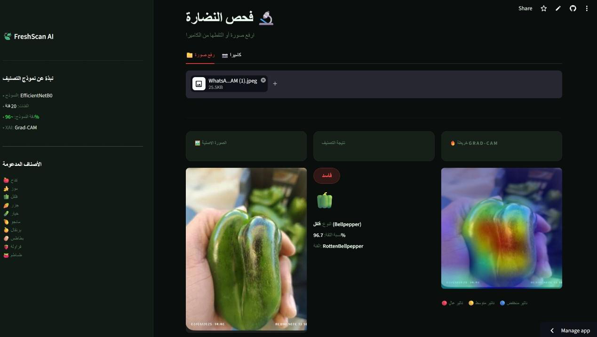
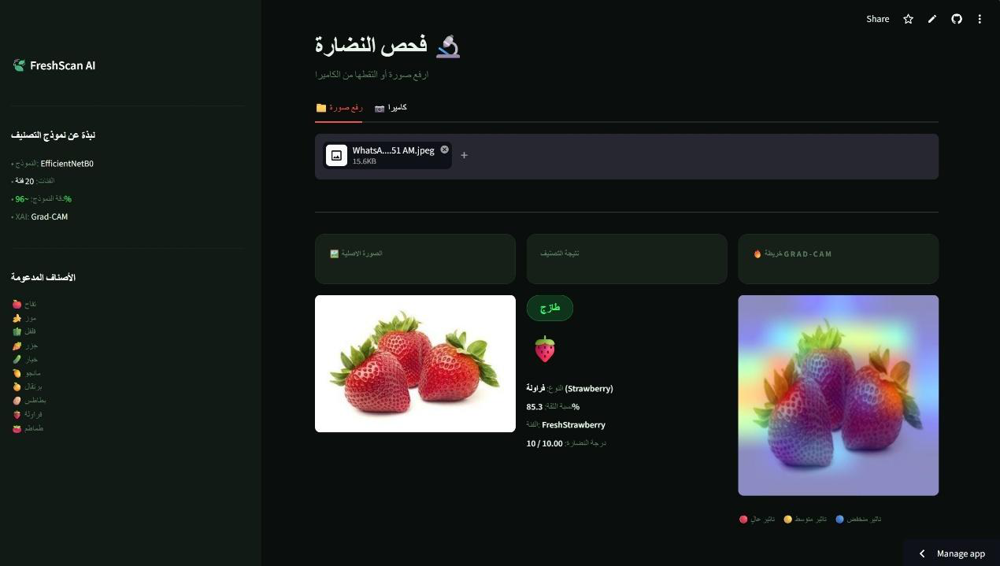
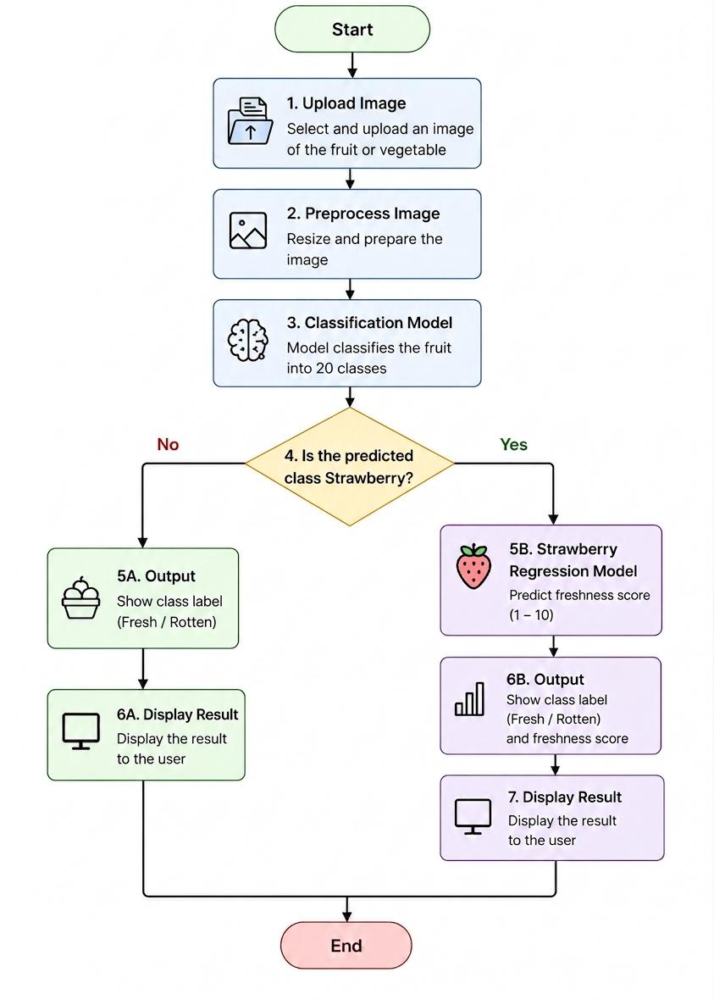
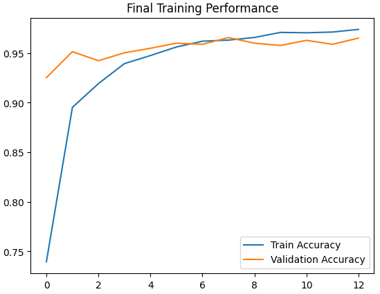
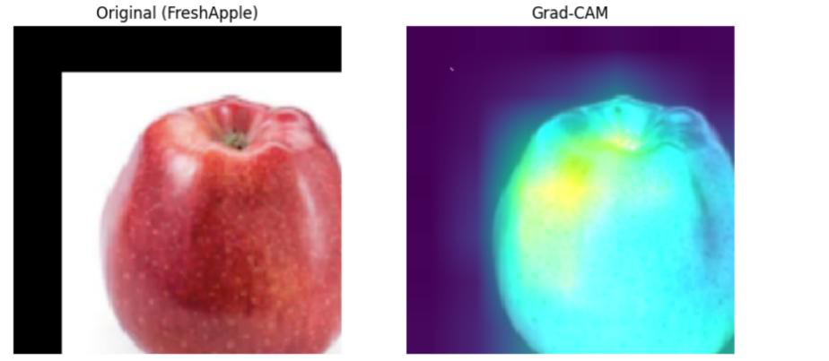
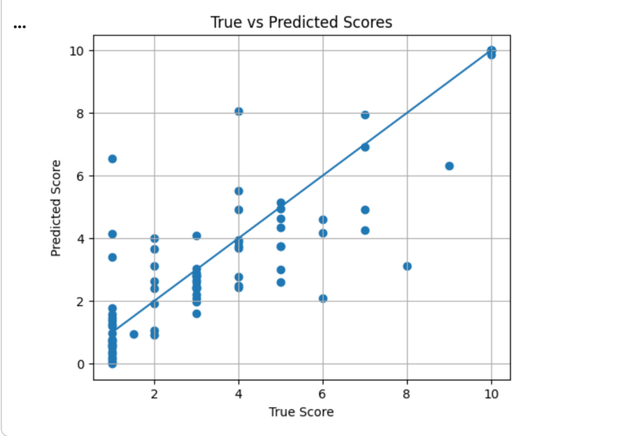

# Explainable Freshness Grading of Fruits & Vegetables

A computer vision system that looks at a photo of produce and answers two questions: **what is it, and is it fresh?** For strawberries it goes one step further and predicts a **freshness score from 1 to 10**. Every prediction comes with a **Grad-CAM heatmap** that shows which part of the image the model based its decision on.

<p align="center">
  
  
</p>

## Highlights

| | |
|---|---|
| **Classification** | EfficientNetB0 (transfer learning), 20 classes, **96.5% test accuracy** |
| **Freshness score** | EfficientNet-B0 regressor (PyTorch), **MAE 0.92 / RMSE 1.43** on a 1–10 scale |
| **Custom dataset** | 572 strawberry images labeled by hand with a freshness score |
| **Explainability** | Grad-CAM heatmaps for every classification |
| **Tuning** | Optuna hyperparameter search plus 11 controlled optimization experiments |
| **Deployment** | Streamlit web app with image upload and camera capture |

## How it works

<p align="center"></p>

1. **Data preparation:** Uses the [Fruits & Vegetables dataset](https://www.kaggle.com/datasets/muhriddinmuxiddinov/fruits-and-vegetables-dataset) (12,000 images, 10 items × fresh/rotten). 232 duplicate images were removed with MD5 hashing, corrupted files were checked, and the train/test split was verified to have no leakage.
2. **Classification:** EfficientNetB0 pre-trained on ImageNet with a custom head. Optuna picked the learning rate, optimizer, dropout, weight decay, batch size and head size.
3. **Freshness regression (strawberries):** A separate EfficientNet-B0 regressor in PyTorch trained on the hand-labeled subset, using:
   - ImageNet normalization
   - A custom **Weighted Huber Loss**
   - A regression-aware weighted sampler
   - Extra augmentation for the minority "fresh" class
4. **Explainability:** Grad-CAM highlights the regions that drove each prediction, so you can check the model is looking at mold and bruises and not at the background.

## Results

### Classification

| Model | Validation accuracy |
|---|---|
| **Baseline EfficientNetB0 (frozen backbone, CE loss)** | **97.09%** |
| + Focal Loss | 97.09% |
| + AdamW | 96.75% |
| + Focal Loss + AdamW | 96.36% |
| + Fine-tuning top layers | 92.11% |

The full set of experiments is in [`03_optimization_experiments.ipynb`](notebooks/03_optimization_experiments.ipynb). It also covers a deeper head, LR callbacks, L2, label smoothing, advanced augmentation, a cosine LR schedule and MixUp. None of these beat the simple frozen-backbone baseline within the same training budget. The baseline scored **96.53% on the held-out test set**.

<p align="center">
  
  
</p>

### Strawberry freshness score

| Metric | Test |
|---|---|
| MAE | **0.92** |
| RMSE | 1.43 |

On average, predictions are less than one point away from the human-assigned score.

<p align="center"></p>

## Repository structure

```
notebooks/
  01_classification_efficientnet.ipynb      # data cleaning, Optuna tuning, training, evaluation, Grad-CAM
  02_strawberry_freshness_regression.ipynb  # freshness-score regressor (PyTorch)
  03_optimization_experiments.ipynb         # 11 controlled experiments vs. the baseline
data/
  strawberry_freshness_scores.csv           # hand-made labels: image name -> score (1–10)
images/                                     # figures used in this README
```

## Running it

The notebooks were built for **Google Colab with a GPU**.

```bash
pip install -r requirements.txt
```

- **Notebooks 01 and 03** download the dataset automatically with `kagglehub`.
- **Notebook 02** expects:
  - the strawberry images from the same Kaggle dataset (`FreshStrawberry` and `RottenStrawberry` folders)
  - `data/strawberry_freshness_scores.csv`

  Both should be in your Google Drive.

## Tech stack

Python · TensorFlow/Keras · PyTorch · EfficientNet · Optuna · Grad-CAM (tf-explain) · scikit-learn · Streamlit · Google Apps Script (labeling workflow)
